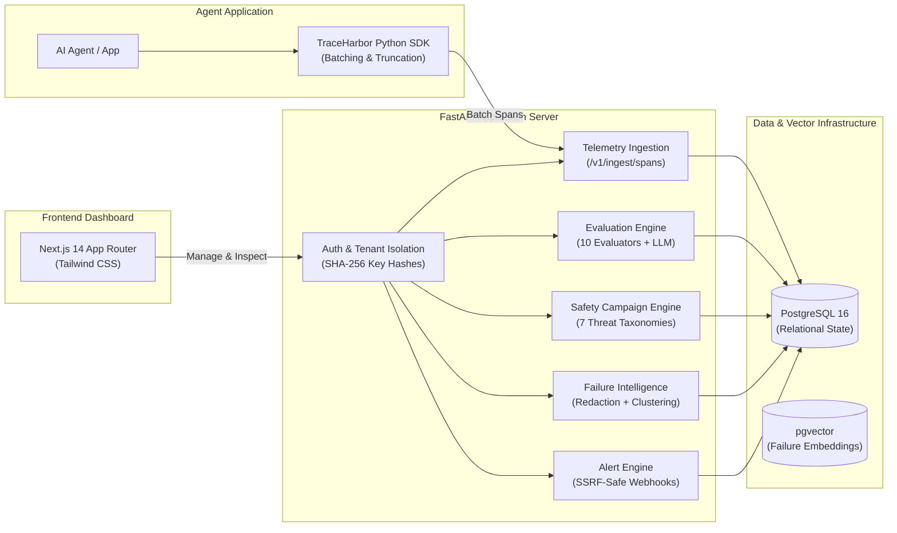
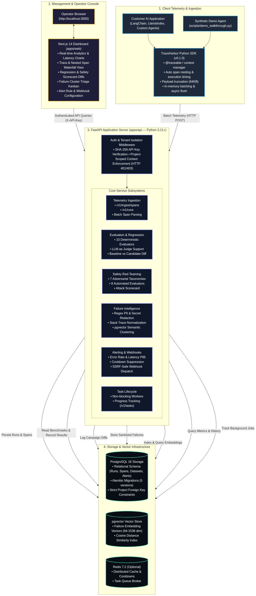

# TraceHarbor

> **Observe. Evaluate. Secure.**<br/>
> *A full-lifecycle AI agent observability, regression evaluation, safety red-teaming, and failure-intelligence platform.*

[](https://github.com/priyanshu150106/TraceHarbor---AI-AGENT-INTELLIGENCE-PLATFORM/actions/workflows/ci.yml)
[](https://github.com/priyanshu150106/TraceHarbor---AI-AGENT-INTELLIGENCE-PLATFORM/releases/tag/v0.1.0-rc2)
[](https://www.python.org/downloads/)
[](https://fastapi.tiangolo.com)
[](https://nextjs.org/)
[](https://github.com/pgvector/pgvector)
[](https://github.com/priyanshu150106/TraceHarbor---AI-AGENT-INTELLIGENCE-PLATFORM/actions)

---

## The Engineering Problem

Traditional Application Performance Monitoring (APM) tools are built for deterministic, request-response web services. AI agent applications fail differently:

1. **Opaque Multi-Step Execution**: Complex agent architectures (ReAct loops, planner-executor graphs, tool invocation chains) make it difficult to diagnose where execution diverged, timed out, or consumed excessive tokens.
2. **Silent Quality Regressions**: Prompt tweaks or underlying LLM model updates can silently degrade downstream agent accuracy without throwing traditional HTTP or runtime exceptions.
3. **Adversarial Safety Vulnerabilities**: Agents with external tool access are vulnerable to prompt injections, jailbreaks, system prompt extraction, and unintended PII exfiltration.
4. **Unstructured Failure Proliferation**: LLM output parsing failures and third-party API rate limits produce noisy, repetitive logs that overwhelm engineering teams without automated root-cause grouping.

TraceHarbor provides an integrated, end-to-end platform engineered specifically to capture, evaluate, protect, and cluster AI agent workloads.

---

## Key Capabilities

| Subsystem | Implemented Capability | Implementation Path |
|:---|:---|:---|
| **Telemetry Ingestion** | Asynchronous span collection, parent-child execution hierarchies, automatic 64 KB payload truncation, and token usage metrics. | `packages/sdk-python`<br/>`apps/api/app/api/v1/ingest.py` |
| **Agent Evaluation** | Golden dataset management, 10 deterministic evaluators (regex, JSON schema, BLEU/ROUGE, Levenshtein), and LLM-as-a-judge scorers. | `apps/api/app/services/evaluation.py`<br/>`apps/api/app/evaluators/` |
| **Regression Analysis** | Direct baseline vs. candidate experiment comparisons with metric shift deltas and individual test regression flags. | `apps/api/app/api/v1/experiments.py`<br/>`apps/web/src/app/experiments/compare` |
| **Safety Red-Teaming** | Adversarial benchmark campaigns testing 7 threat categories with 8 automated safety evaluators and risk scorecards. | `apps/api/app/services/safety.py`<br/>`apps/api/app/evaluators/safety/` |
| **Failure Intelligence** | Automated error synchronization, regex PII/secret scrubbing, pgvector semantic clustering, and triage status audit trails. | `apps/api/app/services/failure.py`<br/>`apps/api/app/models/failure.py` |
| **Alerting & Webhooks** | Metric threshold triggers (error rate, P95 latency) with cooldown suppression and SSRF-safe outbound webhook delivery. | `apps/api/app/services/alert.py`<br/>`apps/api/app/api/v1/alerts.py` |
| **Tenant Isolation** | SHA-256 hashed API key authentication with strict database-level project boundary filtering. | `apps/api/app/core/auth.py`<br/>`apps/api/app/models/project.py` |
| **Abuse & Rate Limiting** | Reverse proxy IP anti-spoofing (`CF-Connecting-IP`, rightmost `X-Forwarded-For`), pure ASGI streaming body guard (10 MB), and bounded LRU rate limiter. | `apps/api/app/core/rate_limit.py`<br/>`apps/api/app/core/middleware.py` |
| **Operator Dashboard** | Responsive web console with trace waterfalls, regression scorecards, cluster triage kanbans, and latency charts. | `apps/web/src/app/` (18 routes) |

---

## Architecture



<p align="center">
  
</p>

> **Architecture Diagram Source**: The complete, editable Mermaid architecture specification is maintained in [`docs/assets/traceharbor-architecture.mmd`](docs/assets/traceharbor-architecture.mmd).

---

## Technology Stack

| Layer | Technologies | Verification |
|:---|:---|:---|
| **Backend API** | Python 3.11+, FastAPI 0.115+, Pydantic v2, Async SQLAlchemy 2.0, Alembic (5 migrations) | Verified in `apps/api/pyproject.toml` |
| **Web Dashboard** | Next.js 14.2 (App Router), React 18, TypeScript 5, Tailwind CSS, Lucide Icons | Verified in `apps/web/package.json` |
| **Python SDK** | Python 3.11+, HTTPX, Pydantic, In-Memory Span Batching, Zero-Dependency Core | Verified in `packages/sdk-python/pyproject.toml` |
| **Storage & Search** | PostgreSQL 16, pgvector (dense vector similarity), Redis 7 (optional cache) | Verified in `docker-compose.yml` |
| **Verification & CI** | Pytest, Ruff linter, Next.js typecheck/lint/build, GitHub Actions CI | Verified in `.github/workflows/ci.yml` |

---

## Quick Start

### Option A: 60-Second In-Memory Verification (No Docker Needed)
Inspect the entire 9-subsystem platform lifecycle using the self-contained verification runner:

```bash
# Clone the repository
git clone https://github.com/priyanshu150106/TraceHarbor---AI-AGENT-INTELLIGENCE-PLATFORM.git
cd TraceHarbor

# Run the complete end-to-end verification suite in-process
python scripts/demo_walkthrough.py --in-memory
```
*Executes all 9 subsystems (health verification, telemetry ingestion, evaluation experiments, safety red-teaming, PII redaction, clustering, alerts, async tasks, and tenant boundary checks) in ~4 seconds.*

### Option B: Full Containerized Stack (Docker Compose)
For full multi-service deployment with persistent PostgreSQL 16 and pgvector:

```bash
# Start backend, database, vector store, and frontend
docker compose up -d

# Verify container health
docker compose ps
```
- **Operator Dashboard**: `http://localhost:3000`
- **FastAPI Documentation**: `http://localhost:8000/docs`
- **Health Check**: `http://localhost:8000/health`

*For complete step-by-step setup and local development details, see [`docs/DEVELOPMENT.md`](docs/DEVELOPMENT.md) and [`docs/DEMO.md`](docs/DEMO.md).*

---

## Demonstration Workflow

A reviewer or interviewer can validate the full feature surface in under 5 minutes:

1. **Instrument an Agent**: Decorate any agent function with `@traceable` using `packages/sdk-python`.
2. **Inspect Telemetry**: Review parent-child span execution trees, latency breakdowns, and payload inputs on `/runs`.
3. **Run Regression Benchmarks**: Upload a golden dataset and execute candidate vs. baseline experiments on `/experiments/compare`.
4. **Execute Safety Campaigns**: Audit against prompt injection and jailbreak threats on `/safety/campaigns`.
5. **Triage Failure Clusters**: Investigate PII-sanitized error groups clustered by vector similarity on `/failures/clusters`.
6. **Trigger Alert Rules**: Configure error-rate rules and verify cooldown suppression and SSRF protection on `/alerts`.

*Review the complete verbal walkthrough and presentation script in [`docs/PORTFOLIO_DEMO_SCRIPT.md`](docs/PORTFOLIO_DEMO_SCRIPT.md).*

---

## Dashboard & Visual Assets

| Dashboard Subsystem | Visual Documentation | Route |
|:---|:---|:---|
| **System Overview** | [`01-dashboard-overview.png`](docs/assets/screenshots/01-dashboard-overview.png) (KPI cards, error rates, latency percentiles) | `/` |
| **Runs & Waterfall** | [`02-runs-waterfall.png`](docs/assets/screenshots/02-runs-waterfall.png) & [`02-trace-detail.png`](docs/assets/screenshots/02-trace-detail.png) (Span hierarchy tree & payload inspector) | `/runs`, `/runs/[id]` |
| **Regression Diff** | [`03-experiment-regression.png`](docs/assets/screenshots/03-experiment-regression.png) & [`03-experiment-compare.png`](docs/assets/screenshots/03-experiment-compare.png) (Baseline vs. candidate comparison) | `/experiments`, `/experiments/compare` |
| **Safety Scorecard** | [`04-safety-campaign.png`](docs/assets/screenshots/04-safety-campaign.png) (Adversarial red-team suites & breach audit) | `/safety/campaigns` |
| **Failure Intelligence** | [`05-failure-clusters.png`](docs/assets/screenshots/05-failure-clusters.png) (Normalized failure event feed & sanitized summaries) | `/failures` |
| **Alert Rules** | [`06-alert-rules.png`](docs/assets/screenshots/06-alert-rules.png) (Metric threshold monitors & SSRF-safe webhook logs) | `/alerts` |

> All dashboard screenshots are captured directly from the live running application using synthetic benchmark telemetry. See [`docs/assets/screenshots/README.md`](docs/assets/screenshots/README.md) for capture specifications and environment details.

---

## Test Coverage & Quality Assurance

| Test Category | Scope | Count | Status |
|:---|:---|:---|:---|
| **Backend Unit & Security** | FastAPI routes, evaluation algorithms, safety red-teaming, rate limits, anti-spoofing, payload guards | 151 tests | ✅ 151 passed |
| **Python SDK** | Decorators, span timing, payload truncation, batch flush logic | 10 tests | ✅ 10 passed |
| **Integration (PostgreSQL)** | Alembic migration chains (001–005), pgvector similarity queries, database constraints | 11 tests | ✅ Verified in CI |
| **Frontend Production Build** | Next.js 14 TypeScript typechecking, ESLint rules, static/dynamic route compilation | 18 routes | ✅ Compiled clean |
| **Automated Walkthrough** | Complete 9-subsystem end-to-end integration verification | 9 checks | ✅ 9/9 passed |

Run the test suite locally:
```bash
# Run 161 in-memory backend and SDK tests
pytest apps/api/app/tests packages/sdk-python/tests -v -m "not integration"

# Verify Next.js frontend compilation
cd apps/web && npm run build
```

---

## Security Architecture

- **Zero-Knowledge API Keys**: API keys are hashed with SHA-256 before storage; raw tokens are never persisted.
- **Tenant Boundary Isolation**: All database queries strictly enforce `project_id` scoping to prevent cross-tenant data leakage.
- **Reverse Proxy Anti-Spoofing**: Inspects `CF-Connecting-IP` and traverses `X-Forwarded-For` right-to-left from trusted proxies; validates IPv4/IPv6 syntax to prevent rate-limit evasion.
- **Pure ASGI Streaming Body Limiter**: Immediate HTTP 413 rejection for declared bodies > 10 MB and monitored chunk streaming abort for chunked/un-declared transfers.
- **Safe Public Demo Mode**: Dedicated private seeding (`scripts/seed_demo_data.py`) with transaction rollback; unauthenticated visitors are strictly read-only with mutation attempts blocked with HTTP 403.
- **PII & Credential Scrubbing**: Failure synchronization pipelines execute regex sanitization on stack traces and payloads to redact bearer tokens, API keys, and sensitive credentials.
- **SSRF Webhook Guards**: Outbound webhook dispatches validate target hostnames against RFC 1918 private subnets, loopback addresses, and cloud metadata endpoints (`169.254.169.254`).
- **Bounded Inputs**: Enforces strict size limits on dataset uploads (5 MB max, 500 cases max) and SDK payload truncation (64 KB).

*Transparent notice: TraceHarbor is currently a release candidate (`v0.1.0-rc2`) and has not yet undergone third-party commercial security audits.*

---

## Known Limitations

- **In-Process Task State**: Background evaluation tasks currently run in-process using Python `asyncio`. Tasks in flight are interrupted if the API server process restarts (Redis task queue integration planned for production).
- **Embedding Provider Dependency**: Dense vector clustering requires an active embedding provider (OpenAI or local). When unconfigured, the system automatically falls back to deterministic lexical clustering.
- **Local Infrastructure Prerequisites**: Full multi-service PostgreSQL and pgvector deployment requires Docker Desktop. For environments without Docker, the standalone `--in-memory` suite is provided.

---

## Roadmap

- [x] Python SDK with `@traceable` decorator and automatic payload truncation.
- [x] Multi-tenant FastAPI backend with SHA-256 API key authentication.
- [x] Evaluation engine with 10 deterministic evaluators and baseline comparisons.
- [x] Adversarial safety red-teaming across 7 threat taxonomies.
- [x] Failure synchronization, PII redaction, and pgvector semantic clustering.
- [x] SSRF-safe alert webhook notifications with cooldown suppression.
- [x] Next.js 14 operator dashboard with 18 responsive routes.
- [x] Production abuse protections: rate limiter, reverse proxy IP anti-spoofing, ASGI streaming body limiter.
- [x] Private synthetic demo seeder with transaction rollback and non-demo isolation.
- [ ] OpenTelemetry (OTel) span exporter compatibility in Python SDK.
- [ ] Distributed Celery/Redis task queue worker for asynchronous evaluations.
- [ ] TypeScript / JavaScript client SDK for Node.js and browser-based agents.
- [ ] Live WebSocket streaming for real-time span waterfall updates.

---

## License & Documentation

- **License**: Released under the [MIT License](LICENSE).
- **Contributing & Setup**: Review [`docs/DEVELOPMENT.md`](docs/DEVELOPMENT.md) for local setup, code standards, and testing procedures.
- **Deployment Specifications**:
  - [`docs/DEPLOYMENT_READINESS.md`](docs/DEPLOYMENT_READINESS.md): Preflight audit and security verification matrix.
  - [`docs/DEPLOYMENT_RUNBOOK.md`](docs/DEPLOYMENT_RUNBOOK.md): Step-by-step zero-cost cloud deployment runbook for Vercel and Neon ($0.00/mo).
  - [`docs/API_ACCESS_AUDIT.md`](docs/API_ACCESS_AUDIT.md): Complete 24-operation API authorization matrix.
- **Interview & Technical Guide**: For detailed architectural deep dives and hiring manager Q&A, refer to [`docs/INTERVIEW_GUIDE.md`](docs/INTERVIEW_GUIDE.md).
