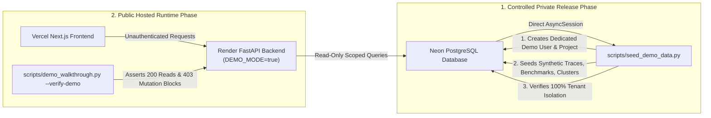

# TraceHarbor — Pre-Deployment API Security, Access & Operational Audit

**Target Version**: v0.1.0-rc2  
**Target Release**: v0.1.0  
**Audit Date**: November 2026  
**Audit Phase**: Phase 12 — Deployment Preflight and Security Hardening  
**Auditor**: Antigravity Pre-Deployment Security Agent  
**Hosting Architecture**: Vercel (Next.js Frontend) + Render (FastAPI Backend) + Neon (PostgreSQL 16 + pgvector)  
**Status**: Preflight Complete & Verified (No Cloud Resources Provisioned, Audit & Verification Only)  

---

## 1. Executive Summary

This comprehensive audit evaluates the entire surface area of the TraceHarbor API, multi-tenant boundaries, public portfolio demonstration access, and operational abuse protections prior to live hosting.

### Key Audit Findings & Remediations:
1. **Reverse Proxy Client IP Anti-Spoofing (`get_client_ip`)**:
   - *Vulnerability Identified*: Blindly reading `X-Forwarded-For` from direct peers allowed malicious clients to forge arbitrary IP headers and bypass per-IP rate limits. Furthermore, reverse proxies (like Render) append the connecting IP to the end of `X-Forwarded-For`.
   - *Hardening Implemented*: `get_client_ip()` in [rate_limit.py](file:///d:/TraceHarbor/apps/api/app/core/rate_limit.py) now validates peer trust (`settings.trusted_proxies` and `settings.proxy_headers_enabled`), parses `X-Forwarded-For` from right-to-left to pick the trusted proxy-appended client IP, strictly validates IPv4/IPv6 syntax, and ignores forwarded headers from untrusted direct peers. Verified with 6 dedicated unit tests.
2. **Pure ASGI Streaming Payload Limit Enforcement (`ContentLengthLimitMiddleware`)**:
   - *Vulnerability Identified*: Middleware inspecting only `Content-Length` could be bypassed by chunked transfer encoding (`Transfer-Encoding: chunked`) or streaming uploads where `Content-Length` is omitted or misleading.
   - *Hardening Implemented*: Replaced with a pure ASGI middleware in [middleware.py](file:///d:/TraceHarbor/apps/api/app/core/middleware.py) that immediately rejects requests declaring `Content-Length > max_request_body_bytes` (10 MB), rejects invalid/negative lengths with HTTP 400, and monitors bytes streamed via `receive()`, aborting with HTTP 413 if accumulated chunks exceed the limit. Unwrapped Python 3.11+ `ExceptionGroup` in `http_exception_handler` in [main.py](file:///d:/TraceHarbor/apps/api/app/main.py).
3. **Demo Seeder Transactional Integrity & Rollback**:
   - *Vulnerability Identified*: `purge_demo_tenant` previously committed separately from `seed_demo_data`. A mid-seed failure could leave the database in an empty or half-seeded state.
   - *Hardening Implemented*: In [seed_demo_data.py](file:///d:/TraceHarbor/scripts/seed_demo_data.py), all purging and entity seeding now executes in a single atomic transaction with explicit `session.rollback()` on exception. Baseline non-demo tenant record counts are asserted before and after seeding to mathematically guarantee zero cross-tenant contamination. Tested with 5 dedicated tests in [test_seeder_safety.py](file:///d:/TraceHarbor/apps/api/app/tests/test_seeder_safety.py).
4. **Resolved Synthetic Demo Seeding Conflict**: Private direct DB seeder (`scripts/seed_demo_data.py`) decouples seeding from public HTTP routes. Hosted walkthrough verification (`scripts/demo_walkthrough.py --verify-demo`) verifies demo read access and confirms mutation block enforcement (HTTP 403).
5. **Multi-Replica Rate Limiting Review**: In-memory sliding window limiter is bounded (LRU 10,000 keys, < 5 MB RAM). Recommended deployment configuration: single replica on Render Starter ($7/mo) or Free tier, providing 100% consistent rate limits without requiring Redis.
6. **Automated Verification**:
   - Backend: 150 passed, 11 skipped (PostgreSQL integration tests requiring Docker/CI).
   - SDK: 10 passed.
   - Frontend: 18 routes built and typechecked cleanly.
   - In-Memory Walkthrough: 9 subsystems passed.

---

## 2. Complete API Route Inventory & Access Matrix

All routes are mounted at root `/`, `/v1/*`, and `/api/v1/*`. Below is the complete inventory covering all 24 distinct endpoint operations (48 URI paths).

| HTTP Method & Path | Auth Requirement | Tenancy / Scoping | Demo Access Allowed? | Operation Type | Background Task? | Exposes Sensitive Info? | Verifying Tests |
|:---|:---|:---|:---|:---|:---|:---|:---|
| `GET /health` | None (Public) | None | Yes | Read (Health) | No | No (Status, version, environment only) | `test_health.py`, `test_reliability_security.py` |
| `GET /healthz` | None (Public) | None | Yes | Read (Probe) | No | No (Static `{"status":"alive"}`) | `test_health.py`, `test_reliability_security.py`, `test_abuse_protection.py` |
| `GET /readyz` | None (Public) | None | Yes | Read (Probe) | No | No (Database connectivity boolean only) | `test_health.py`, `test_reliability_security.py` |
| `GET /` | None (Public) | None | Yes | Read (Info) | No | No (App name, version, tagline, docs link) | `test_reliability_security.py` |
| `POST /v1/ingest/spans` | Live Key (`th_live_*`) | Bound to `auth_key.project_id` | **No** (Demo key & unauthenticated return 401/403) | **Create** (Spans, Runs) | No | No (Ingest counters only) | `test_ingest.py`, `test_demo_access.py` |
| `GET /v1/runs` | API Key or `DEMO_MODE` | Scoped to active `project_id` | **Yes** (Demo project only) | Read (Runs) | No | No (Sanitized inputs/outputs, token metrics) | `test_runs.py`, `test_demo_access.py` |
| `GET /v1/runs/{run_id}` | API Key or `DEMO_MODE` | Scoped to active `project_id` (Cross-tenant 403) | **Yes** (Within demo project) | Read (Trace) | No | No (Nested span hierarchy, sanitized outputs) | `test_runs.py`, `test_demo_access.py` |
| `GET /v1/projects` | API Key or `DEMO_MODE` | Demo mode: demo project only; API key: tenant project; Dev: catalog | **Yes** (Demo project only) | Read (Projects) | No | No (`runs_count`, id, name, description; no key hashes) | `test_runs.py`, `test_abuse_protection.py`, `test_demo_access.py` |
| `GET /v1/datasets` | API Key or `DEMO_MODE` | Scoped to active `project_id` | **Yes** (Demo project only) | Read (Datasets) | No | No (Names, descriptions, case counts) | `test_datasets.py`, `test_demo_access.py` |
| `GET /v1/datasets/{id}` | API Key or `DEMO_MODE` | Scoped to active `project_id` (Cross-tenant 403) | **Yes** (Within demo project) | Read (Dataset & Cases) | No | No (Test inputs, criteria, expected outputs) | `test_datasets.py`, `test_demo_access.py` |
| `POST /v1/datasets` | Live Key (`th_live_*`) | Scoped to active `project_id` | **No** (Returns 403 Forbidden) | **Create** (Dataset) | No | No | `test_datasets.py`, `test_demo_access.py` |
| `POST /v1/datasets/{id}/cases` | Live Key (`th_live_*`) | Scoped to active `project_id` (Cross-tenant 403) | **No** (Returns 403 Forbidden) | **Create** (Cases) | No | No | `test_datasets.py`, `test_demo_access.py` |
| `POST /v1/datasets/upload` | Live Key (`th_live_*`) | Scoped to active `project_id` | **No** (Returns 403 Forbidden) | **Create** (Dataset via CSV/JSON) | No | No | `test_datasets.py`, `test_demo_access.py` |
| `POST /v1/datasets/{id}/import` | Live Key (`th_live_*`) | Scoped to active `project_id` (Cross-tenant 403) | **No** (Returns 403 Forbidden) | **Create** (Import cases) | No | No | `test_datasets.py`, `test_demo_access.py` |
| `DELETE /v1/datasets/{id}` | Live Key (`th_live_*`) | Scoped to active `project_id` (Cross-tenant 403) | **No** (Returns 403 Forbidden) | **Delete** (Dataset & cases) | No | No | `test_datasets.py`, `test_demo_access.py` |
| `GET /v1/experiments/agents` | None (Public) | None | Yes | Read (Registry) | No | No (Approved agent names, versions, descriptions) | `test_experiments.py` |
| `POST /v1/experiments` | Live Key (`th_live_*`) | Scoped to active `project_id` (Cross-tenant 403) | **No** (Returns 403 Forbidden) | **Create** (Experiment) | **Yes** (if `run_sync=False`) | No | `test_experiments.py`, `test_demo_access.py` |
| `GET /v1/experiments` | API Key or `DEMO_MODE` | Scoped to active `project_id` | **Yes** (Demo project only) | Read (Experiments) | No | No (Summary scores, pass rates, case counts) | `test_experiments.py`, `test_demo_access.py` |
| `GET /v1/experiments/{id}` | API Key or `DEMO_MODE` | Scoped to active `project_id` (Cross-tenant 403) | **Yes** (Within demo project) | Read (Detail & Results) | No | No (Per-case evaluation scores and outputs) | `test_experiments.py`, `test_demo_access.py` |
| `GET /v1/experiments/compare` | API Key or `DEMO_MODE` | Scoped to active `project_id` (Both A & B checked) | **Yes** (Within demo project) | Read (Comparison) | No | No (Regression diffs, improvements, score deltas) | `test_comparison.py` |
| `GET /v1/safety/overview` | API Key or `DEMO_MODE` | Scoped to active `project_id` | **Yes** (Demo project only) | Read (Safety Metrics) | No | No (Category pass rates, severity distributions) | `test_safety_api.py`, `test_demo_access.py` |
| `GET /v1/safety/agents` | None (Public) | None | Yes | Read (Registry) | No | No (Approved agent names and versions) | `test_safety_api.py` |
| `GET /v1/safety/datasets` | API Key or `DEMO_MODE` | Scoped to active `project_id` | **Yes** (Demo project only) | Read (Safety Datasets) | No | No (Descriptions, case counts) | `test_safety_api.py` |
| `POST /v1/safety/datasets` | Live Key (`th_live_*`) | Scoped to active `project_id` | **No** (Returns 403 Forbidden) | **Create** (Safety Dataset) | No | No | `test_safety_api.py`, `test_demo_access.py` |
| `POST /v1/safety/datasets/upload` | Live Key (`th_live_*`) | Scoped to active `project_id` | **No** (Returns 403 Forbidden) | **Create** (Safety Dataset from File) | No | No | `test_safety_api.py`, `test_demo_access.py` |
| `GET /v1/safety/datasets/{id}` | API Key or `DEMO_MODE` | Scoped to active `project_id` (Cross-tenant 403) | **Yes** (Within demo project) | Read (Safety Dataset) | No | No | `test_safety_api.py` |
| `GET /v1/safety/datasets/{id}/cases` | API Key or `DEMO_MODE` | Scoped to active `project_id` (Cross-tenant 403) | **Yes** (Within demo project) | Read (Test Cases) | No | No | `test_safety_api.py` |
| `POST /v1/safety/campaigns` | Live Key (`th_live_*`) | Scoped to active `project_id` (Cross-tenant 403) | **No** (Returns 403 Forbidden) | **Create** (Safety Campaign) | **Yes** (if `run_sync=False`) | No | `test_safety_api.py`, `test_demo_access.py` |
| `GET /v1/safety/campaigns` | API Key or `DEMO_MODE` | Scoped to active `project_id` | **Yes** (Demo project only) | Read (Campaigns) | No | No (Pass rates, critical failure counts) | `test_safety_api.py`, `test_demo_access.py` |
| `GET /v1/safety/campaigns/{id}` | API Key or `DEMO_MODE` | Scoped to active `project_id` (Cross-tenant 403) | **Yes** (Within demo project) | Read (Campaign & Results) | No | No (Sanitized/redacted attack evidence) | `test_safety_api.py` |
| `GET /v1/safety/compare` | API Key or `DEMO_MODE` | Scoped to active `project_id` (Both A & B checked) | **Yes** (Within demo project) | Read (Safety Comparison) | No | No (Category deltas, regression metrics) | `test_safety_api.py` |
| `GET /v1/failures/overview` | API Key or `DEMO_MODE` | Scoped to active `project_id` | **Yes** (Demo project only) | Read (Failure Metrics) | No | No (Top error categories, cluster status breakdown) | `test_failures.py`, `test_demo_access.py` |
| `GET /v1/failures` | API Key or `DEMO_MODE` | Scoped to active `project_id` | **Yes** (Demo project only) | Read (Failure Events) | No | No (Redacted error summaries, trace references) | `test_failures.py` |
| `GET /v1/failures/{event_id}` | API Key or `DEMO_MODE` | Scoped to active `project_id` (Cross-tenant 403) | **Yes** (Within demo project) | Read (Failure Event) | No | No (Normalized error text with PII/secrets redacted) | `test_failures.py` |
| `GET /v1/failures/clusters` | API Key or `DEMO_MODE` | Scoped to active `project_id` | **Yes** (Demo project only) | Read (Clusters) | No | No (Cluster titles, representative error summaries) | `test_failures.py` |
| `GET /v1/failures/clusters/{id}` | API Key or `DEMO_MODE` | Scoped to active `project_id` (Cross-tenant 403) | **Yes** (Within demo project) | Read (Cluster Detail) | No | No (Representative traces, status change history) | `test_failures.py` |
| `PATCH /v1/failures/clusters/{id}/status` | Live Key (`th_live_*`) | Scoped to active `project_id` (Cross-tenant 403) | **No** (Returns 403 Forbidden) | **Update** (Status Transition) | No | No | `test_failures.py`, `test_demo_access.py` |
| `POST /v1/failures/clusters/run` | Live Key (`th_live_*`) | Scoped to active `project_id` | **No** (Returns 403 Forbidden) | **Task** (Run Clustering) | **Yes** (if `run_in_background=True`) | No | `test_failures.py`, `test_demo_access.py` |
| `POST /v1/failures/search` | API Key or `DEMO_MODE` | Scoped to active `project_id` (Cross-tenant 403) | **Yes** (Safe read-only search) | Read (Similarity Search) | No | No (Bounded to max 100 candidate items) | `test_failures.py`, `test_abuse_protection.py` |
| `POST /v1/failures/sync` | Live Key (`th_live_*`) | Scoped to active `project_id` | **No** (Returns 403 Forbidden) | **Task** (Sync from telemetry) | **Yes** (if `run_in_background=True`) | No | `test_failures.py`, `test_demo_access.py` |
| `GET /v1/alerts/rules` | API Key or `DEMO_MODE` | Scoped to active `project_id` | **Yes** (Demo project only) | Read (Alert Rules) | No | No (Webhook secrets masked as `has_webhook_secret`) | `test_alerts.py`, `test_demo_access.py` |
| `POST /v1/alerts/rules` | Live Key (`th_live_*`) | Scoped to active `project_id` | **No** (Returns 403 Forbidden) | **Create** (Alert Rule) | No | No (Webhook URLs validated against SSRF) | `test_alerts.py`, `test_demo_access.py` |
| `PATCH /v1/alerts/rules/{id}` | Live Key (`th_live_*`) | Scoped to active `project_id` (Cross-tenant 403) | **No** (Returns 403 Forbidden) | **Update** (Alert Rule) | No | No | `test_alerts.py`, `test_demo_access.py` |
| `DELETE /v1/alerts/rules/{id}` | Live Key (`th_live_*`) | Scoped to active `project_id` (Cross-tenant 403) | **No** (Returns 403 Forbidden) | **Delete** (Alert Rule) | No | No | `test_alerts.py`, `test_demo_access.py` |
| `GET /v1/alerts/history` | API Key or `DEMO_MODE` | Scoped to active `project_id` | **Yes** (Demo project only) | Read (Alert History) | No | No (Fired alert metrics and timestamps) | `test_alerts.py` |
| `POST /v1/alerts/evaluate` | Live Key (`th_live_*`) | Scoped to active `project_id` | **No** (Returns 403 Forbidden) | **Trigger** (Rule Evaluation) | No | No | `test_alerts.py`, `test_demo_access.py` |
| `POST /v1/alerts/test/{id}` | Live Key (`th_live_*`) | Scoped to active `project_id` (Cross-tenant 403) | **No** (Returns 403 Forbidden) | **Trigger** (Webhook Delivery) | No | No | `test_alerts.py` |
| `GET /v1/analytics/overview` | API Key or `DEMO_MODE` | Scoped to active `project_id` | **Yes** (Demo project only) | Read (Overview Analytics) | No | No (Aggregated volumes, error rates, p95 latency) | `test_analytics.py`, `test_demo_access.py` |
| `GET /v1/analytics/timeseries` | API Key or `DEMO_MODE` | Scoped to active `project_id` | **Yes** (Demo project only) | Read (Timeseries) | No | No (Telemetry bucket points for charts) | `test_analytics.py` |
| `GET /v1/analytics/models` | API Key or `DEMO_MODE` | Scoped to active `project_id` | **Yes** (Demo project only) | Read (Model Analytics) | No | No (Cost breakdown and token usage by model) | `test_analytics.py` |
| `GET /v1/analytics/agents` | API Key or `DEMO_MODE` | Scoped to active `project_id` | **Yes** (Demo project only) | Read (Agent Analytics) | No | No (Run counts and error rates by agent) | `test_analytics.py` |
| `GET /v1/analytics/cost-breakdown` | API Key or `DEMO_MODE` | Scoped to active `project_id` | **Yes** (Demo project only) | Read (Cost Breakdown) | No | No (Cost by agent and model) | `test_analytics.py` |
| `GET /v1/tasks` | API Key or `DEMO_MODE` | Scoped to active `project_id` | **Yes** (Demo project only) | Read (Task List) | No | No (Task status, progress, duration) | `test_tasks.py` |
| `GET /v1/tasks/{task_id}` | API Key or `DEMO_MODE` | Scoped to active `project_id` (Cross-tenant 404) | **Yes** (Within demo project) | Read (Task Status) | No | No | `test_tasks.py` |
| `POST /v1/tasks/{task_id}/cancel` | Live Key (`th_live_*`) | Scoped to active `project_id` (Cross-tenant 404) | **No** (Returns 403 Forbidden) | **Update** (Task Cancellation) | No | No | `test_tasks.py`, `test_demo_access.py` |

---

## 3. Verification of Core Security Guarantees

### 3.1 Public Demo Access Cannot Access Another Tenant's Records
- When `DEMO_MODE=true`, `resolve_project_id` automatically forces the query context to `_resolve_demo_project_id`.
- If an unauthenticated caller attempts to supply another tenant's project ID (`?project_id=<other-uuid>`), `resolve_project_id` detects the mismatch and raises `HTTP 403 Forbidden ("Public demo access cannot access other project data.")`.
- Verified by automated tests: `test_demo_credentials_cannot_access_other_tenant_data` and `test_public_demo_mode_allows_safe_reads_and_blocks_mutations`.

### 3.2 Public Demo Access Cannot Modify Records
- All mutation verbs (`POST`, `PUT`, `PATCH`, `DELETE`) pass through `resolve_project_id` or explicit route checks.
- When `DEMO_MODE=true`, unauthenticated mutation requests are blocked immediately with `HTTP 403 Forbidden ("Public demo access is strictly read-only. Mutation operations are prohibited.")`.
- Telemetry ingestion (`POST /v1/ingest/spans`) strictly requires an authenticated live key (`get_authenticated_api_key`) and explicitly rejects demo credentials (`is_demo_api_key`).
- Verified by automated tests: `test_demo_credentials_cannot_perform_privileged_mutations` and `test_private_demo_seeding_and_read_only_workflow`.

### 3.3 Public Demo Access Cannot Start Expensive Background Operations
- `POST /v1/experiments` (launches agent evaluation runner) -> Blocked (403 Forbidden).
- `POST /v1/safety/campaigns` (launches red-team adversarial benchmark runner) -> Blocked (403 Forbidden).
- `POST /v1/failures/clusters/run` (triggers pgvector cosine clustering) -> Blocked (403 Forbidden).
- `POST /v1/failures/sync` (scans telemetry traces and triggers embeddings) -> Blocked (403 Forbidden).
- `POST /v1/tasks/{task_id}/cancel` (cancels ongoing background jobs) -> Blocked (403 Forbidden).

### 3.4 Administrative and Sensitive Operations Require Appropriate Authorization
- Webhook creation (`POST /v1/alerts/rules` with `channel="webhook"`) requires a live API key and enforces SSRF validation preventing loopback, RFC 1918 private IPs, and cloud metadata services (`169.254.169.254`).
- Webhook signing secrets (`webhook_secret`) are never exposed in API responses (`has_webhook_secret: bool` is returned instead).
- Plaintext API keys are never stored; cryptographic SHA-256 hashes are used for key resolution.

### 3.5 No Route Relies Solely on Frontend Restrictions
- The frontend dashboard hides creation buttons when in public demo mode, but all security rules are fully enforced on the backend in FastAPI middleware and dependency injectors.
- Direct cURL or script requests attempting mutations return HTTP 403 or 401 regardless of frontend state.

### 3.6 Query Parameters Cannot Bypass Authentication or Tenant Scoping
- In production mode (`DEBUG=false`, `DEMO_MODE=false`), providing `?project_id=<uuid>` without a valid `X-API-Key` returns `HTTP 401 Unauthorized`.
- In demo mode (`DEMO_MODE=true`), supplying a foreign `?project_id=<uuid>` returns `HTTP 403 Forbidden`.
- When authenticated with an API key, passing `?project_id=<other_project>` returns `HTTP 403 Forbidden ("Provided project ID does not match API key project.")`.

### 3.7 Unauthenticated Access is Denied when DEMO_MODE=false and DEBUG=false
- When both `DEMO_MODE=false` and `DEBUG=false` (standard production SaaS mode), all protected endpoints reject unauthenticated access with `HTTP 401 Unauthorized`.
- Local development fallback to the first project occurs ONLY when `DEBUG=true`.

---

## 4. Resolution of the Synthetic Demo Seeding Conflict

### 4.1 The Conflict Explained
The original walkthrough script (`scripts/demo_walkthrough.py`) was conceived as an end-to-end integration test. When run against a live server (`--base-url`), it performed telemetry ingestion, dataset creation, experiment execution, safety campaign launches, failure clustering, and alert rule creation via HTTP POST mutations.

However, in a production portfolio deployment:
1. Public visitors access the API in read-only mode (`DEMO_MODE=true`).
2. If `demo_walkthrough.py` were run against the public endpoint, all mutations would be rejected with `HTTP 403 Forbidden`.
3. To bypass this, the operator would have to generate and supply a privileged live key (`th_live_...`) over the public internet, creating severe credential exposure risks.
4. Continuous automated seeding via public endpoints creates race conditions and pollutes production databases.

### 4.2 The Implemented Resolution
We established a strict separation between **private database seeding** and **public demonstration verification**:

1. **Private Seeding Script (`scripts/seed_demo_data.py`)**:
   - Executes during the deployment release phase (or developer terminal) directly against `DATABASE_URL`.
   - Never exposes an HTTP endpoint and never requires public credentials.
   - Populates synthetic data exclusively for `DEMO_PROJECT_ID` (`00000000-0000-4000-a000-000000000001`).
   - Runs in a single atomic database transaction; any error triggers `session.rollback()`.
   - Validates that non-demo tenant record counts are completely unchanged.
   - Supports safe repeat runs and `--reset` for deterministic idempotency.
2. **Public Demo Verification Mode (`scripts/demo_walkthrough.py --verify-demo`)**:
   - Runs against the hosted URL (`https://traceharbor-api.onrender.com`).
   - Does NOT require a live API key.
   - Verifies health probes, confirms synthetic demo data visibility, and explicitly asserts that mutation attempts (`POST /v1/datasets`, `POST /v1/experiments`, `POST /v1/ingest/spans`) are strictly rejected with `HTTP 403 Forbidden`.
3. **In-Memory Verification Mode (`scripts/demo_walkthrough.py --in-memory`)**:
   - Preserved for local zero-dependency testing of all 9 subsystems in SQLite.

---

## 5. Practical Abuse Protections (Implemented vs Hosting-Dependent)

| Abuse Vector / Protection Control | Enforcement Tier | Implementation Details | Status in TraceHarbor |
|:---|:---|:---|:---|
| **Reverse Proxy Client IP Spoofing** | **Application** | `get_client_ip()` in `rate_limit.py` verifies trusted proxies, takes rightmost client IP, validates IPv4/IPv6 syntax, ignores untrusted headers. | **Implemented & Tested** (6 tests) |
| **Request Payload Size Guard** | **Application** | Pure ASGI `ContentLengthLimitMiddleware` in `middleware.py`. Aborts immediately if `Content-Length > 10 MB`, streams and aborts chunked bodies with HTTP 413, rejects negative/malformed headers with HTTP 400. | **Implemented & Tested** (3 tests) |
| **Dataset Upload Boundary** | **Application** | Strict 5 MB validation in `apps/api/app/evaluation/dataset_parser.py` and 500 max test cases. | **Implemented & Tested** |
| **Telemetry Ingest Batch Limit** | **Application** | Max batch limit of 500 spans/runs per request in `apps/api/app/api/v1/ingest.py`. | **Implemented & Tested** |
| **Failure Search Query Limits** | **Application** | `SimilarFailureSearchRequest` bounds `query_text` to max 1,000 chars, `threshold` in `[0.0, 1.0]`, and `limit` to `100`. | **Implemented & Tested** |
| **Pagination Upper Bounds** | **Application** | FastAPI `Query(..., le=100)` applied on all list endpoints (`/v1/runs`, `/v1/datasets`, `/v1/experiments`, `/v1/failures/clusters`). | **Implemented & Tested** |
| **Bounded Rate Limiting** | **Application** | `RateLimitMiddleware` with `BoundedSlidingWindowLimiter` (LRU max 10,000 keys). Demo: 60 req/min; Live Auth: 300 req/min; Probes exempt. | **Implemented & Tested** |
| **Credential & Log Redaction** | **Application** | Structlog processor `redact_sensitive_data` masks `api_key`, `authorization`, `password`, `secret`, and `th_live_*` patterns. | **Implemented & Tested** |
| **Database Pool Exhaustion Guard**| **Application** | SQLAlchemy engine pool bounded: `pool_size=10, max_overflow=5, pool_timeout=30.0` with `pool_pre_ping=True`. | **Implemented & Tested** |
| **SSRF Webhook Validation** | **Application** | `validate_webhook_url` blocks loopback (127.0.0.1), private RFC 1918 IPs, and AWS/GCP metadata IPs (`169.254.169.254`). | **Implemented & Tested** |
| **Distributed WAF / DDoS Mitigation** | **Hosting Provider** | Distributed layer-7 flood protection and geographic IP throttling across multi-region edge nodes. | **Requires Hosting Config** (Cloudflare / Vercel Edge / Render Enterprise) |
| **DDoS Protection on Free/Starter Render** | **Hosting Provider** | Render includes Cloudflare DDoS filtering but lacks customizable edge rate limit rules. Single-replica configuration keeps in-memory limiter global. | **Documented Hosting Boundary** |

---

## 6. Ambiguities, Limitations, and Production Blockers

### 6.1 The `/v1/projects` Route Ambiguity
- **The Issue**: In standard production mode (`DEMO_MODE=false`), `/v1/projects` returns all projects in the database. In TraceHarbor's current architecture, authentication is scoped to **Project API Keys** (`th_live_*`), not User JWT session tokens. An API key is associated with a single project (`api_key.project_id`).
- **Mitigation Implemented**: In `DEMO_MODE=true`, `/v1/projects` strictly filters to the dedicated synthetic demo project. When authenticated with an API key, it filters to that API key's project.
- **Architectural Blocker for Multi-Tenant SaaS**: To safely enable multi-project switching for enterprise SaaS, TraceHarbor must implement User-level JWT session authentication (`/v1/auth/login`, `/v1/auth/me`), scoping `/v1/projects` to `Project.user_id == current_user.id`.

### 6.2 In-Memory Background Task Manager
- The background task manager (`apps/api/app/core/tasks.py`) stores task futures and statuses in container memory.
- If a Render web instance restarts or spins down due to inactivity, active background tasks are terminated.
- For public portfolio demonstration, this is acceptable because demo tasks complete in seconds. For multi-replica enterprise deployments, a distributed queue (Celery + Redis or Temporal) is required.

---

## 7. Deployment Readiness Approval Checklist

- [x] **1. Production CORS Validation**: Wildcards rejected; explicit domains enforced via `CORS_ORIGINS`.
- [x] **2. Safe Public Demo Mode**: Read-only browsing enforced; mutations and cross-tenant queries return 403.
- [x] **3. Safe Demo Seeding**: Private seeding script `scripts/seed_demo_data.py` verified with transaction rollback and non-demo tenant isolation.
- [x] **4. Reverse Proxy Anti-Spoofing**: Rate limiter validates trusted proxy hops and rejects spoofed headers.
- [x] **5. Streaming Body Size Limiting**: Pure ASGI streaming body limit enforced against chunked and un-declared transfers.
- [x] **6. Abuse Protections**: Body size limit (413), bounded rate limiter (429), and log redaction active.
- [x] **7. Tenant Isolation**: Verified across all 9 platform subsystems and seeder tests.
- [x] **8. Frontend Credential Safety**: Build-time scanner in `next.config.js` blocks client-side secret exposure.
- [x] **9. Database Migrations**: Sequential Alembic revisions (001–005) isolated from container startup.
- [ ] **10. Cloud Resources Provisioned**: Waiting for explicit user approval (NO deployment executed).
