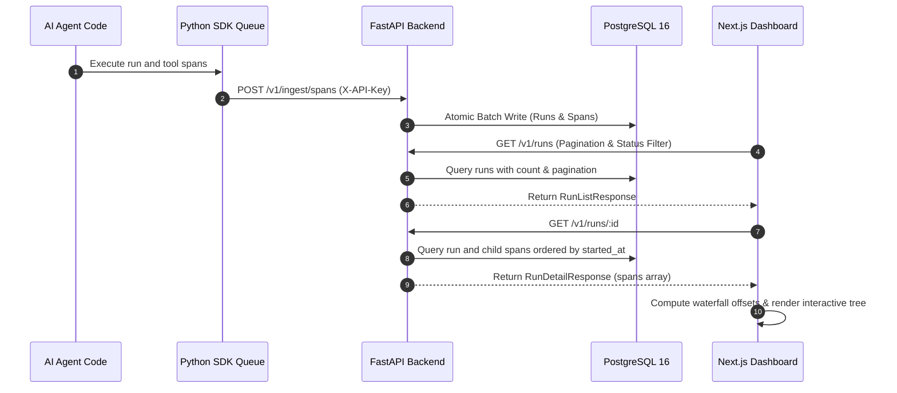
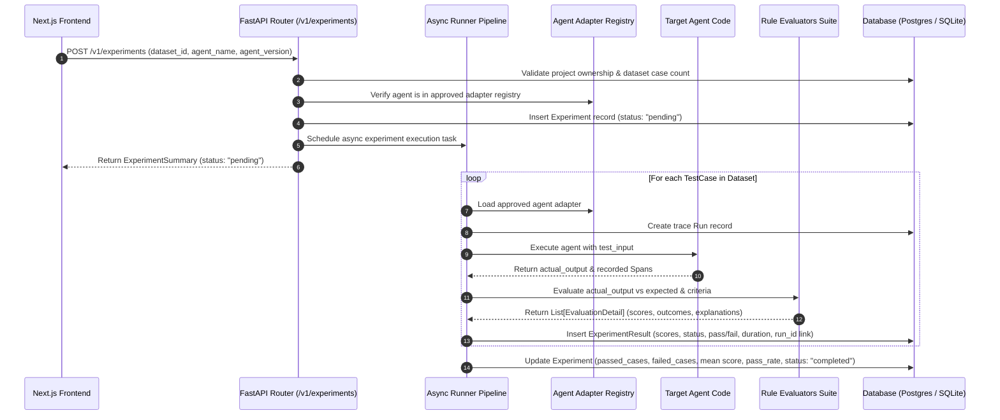

# TraceHarbor — System Architecture

**Observe. Evaluate. Secure.**

TraceHarbor is an AI Agent Observability, Evaluation, and Security Platform designed to trace complex agent executions, inspect nested tool and LLM calls, measure latency and cost, run automated regression benchmarks, and test against adversarial attacks.

---

## 1. High-Level Architecture

```mermaid
flowchart TB
    subgraph ClientAgent["Client Environment"]
        Agent["AI Agent Application"]
        SDK["TraceHarbor Python SDK (packages/sdk-python)"]
        Queue["In-Memory Bounded Queue"]
        Worker["Daemon Flush Thread"]
        
        Agent -->|calls| SDK
        SDK --> Queue
        Queue --> Worker
    end

    subgraph Platform["TraceHarbor Platform"]
        Ingress["FastAPI Ingestion API (POST /v1/ingest/spans)"]
        ReadAPI["FastAPI Read APIs (/v1/runs, /v1/analytics, /v1/projects)"]
        EvalAPI["FastAPI Evaluation APIs (/v1/datasets, /v1/experiments)"]
        Auth["SHA-256 API Key & Tenancy Resolver"]
        Validator["Topological Validator & Cycle Detector"]
        UI["Next.js Web Dashboard (apps/web)"]
        
        subgraph Storage["Data & Cache Tier"]
            Postgres[("PostgreSQL 16 + pgvector")]
            Redis[("Redis 7 Cache / Broker")]
        end
        
        subgraph Engine["Evaluation Engine"]
            Runner["Async Experiment Runner"]
            AgentRegistry["Approved Agent Adapter Registry"]
            EvalRegistry["Rule Evaluator Registry (10 Evaluators)"]
            Judge["Provider-Neutral LLM Judge"]
            DiffEngine["Regression Diff Engine"]
        end
    end

    Worker -->|Async Batch Ingest (X-API-Key)| Ingress
    Ingress --> Auth
    Auth --> Validator
    Validator --> Postgres
    UI -->|REST / JSON| ReadAPI
    UI -->|REST / JSON| EvalAPI
    ReadAPI --> Auth
    EvalAPI --> Auth
    Auth --> Postgres
    EvalAPI --> Runner
    Runner --> AgentRegistry
    Runner --> EvalRegistry
    Runner --> Judge
    Runner --> Postgres
    EvalAPI --> DiffEngine
    DiffEngine --> Postgres
```

---

## 2. Component Responsibilities

### 2.1 Web Dashboard (`apps/web`)
- **Technology:** Next.js 14 (App Router), TypeScript, Tailwind CSS.
- **Responsibilities:**
  - **Overview (`/`):** Real-time operational metrics: total runs, success/error rates, avg/p95 latency percentiles, total tokens, and estimated LLM costs.
  - **Runs Explorer (`/runs`):** Searchable, filterable, and paginated table of agent executions with copyable UUIDs.
  - **Trace Detail (`/runs/[id]`):** Hierarchical collapsible span tree, chronological waterfall timeline with proportional timing bars, and an interactive span inspector drawer for inputs, outputs, models, tokens, and error stack traces.
  - **Datasets (`/datasets`):** Create datasets, inspect test cases, upload JSON/CSV benchmarks, with pagination and validation error previews.
  - **Experiments (`/experiments`):** Launch evaluation experiments against approved agents, track real-time progress, view pass rates and scores.
  - **Experiment Detail (`/experiments/[id]`):** Per-case breakdown, input/output inspection, evaluator outcome explanations, and deep links to execution trace waterfalls.
  - **Regression Diff Engine (`/experiments/compare`):** Side-by-side comparison isolating regressions (passed in baseline, failed in candidate), improvements, delta pass rates, and score differences.
  - **Projects & Settings (`/projects`, `/settings`):** Project directory and diagnostic health monitors.
- **Safe Rendering:** Untrusted agent inputs/outputs are never rendered as raw HTML. Large payloads are formatted and truncated with interactive expansion.

### 2.2 Backend API (`apps/api`)
- **Technology:** Python 3.11+, FastAPI, SQLAlchemy 2.0 (asyncio), Pydantic v2, Alembic.
- **Responsibilities:**
  - Ingestion: `POST /v1/ingest/spans` with cycle detection, topological sorting, and atomic batch persistence.
  - Evaluation & Benchmarking:
    - Datasets: CRUD, paginated case retrieval, transactional CSV/JSON parsing with size & case limits.
    - Experiments: Lifecycle management, async execution runner, trace run/span linkage, and per-case scorecard persistence.
    - Comparison: Case alignment by immutable ID, regression categorization, and score delta calculation.
  - Tenancy isolation: Strict project ownership resolution on every read and write operation.
  - Structured, secret-safe JSON logging with `structlog`.

### 2.3 Python Tracing SDK (`packages/sdk-python`)
- **Technology:** Python library with `httpx` and `pydantic`.
- **Responsibilities:**
  - Zero-friction instrumentation via `@traceharbor.trace(...)` (sync/async) and `with traceharbor.span(...)`.
  - Context propagation: Automatic parent-child span linking across nested functions using Python `contextvars`.
  - Non-blocking execution: Events are queued in memory (`maxsize=5000`) and sent in batches by a daemon thread.
  - Automatic redaction: Masks sensitive keys (`password`, `secret`, `token`, `api_key`).
  - Error isolation: Observability errors never interrupt the host agent.

---

## 3. Data Flow & Waterfall Calculations

### 3.1 Trace Ingestion & Retrieval Sequence



### 3.2 Waterfall Timeline Calculation Approach

To render an accurate visual timeline regardless of clock skew, missing end times, or sub-millisecond durations:
1. **Total Duration Calculation:**
   $$\text{totalDurationMs} = \max\left(1, \max(\text{span.ended\_at}) - \text{run.started\_at}, \text{run.duration\_ms}\right)$$
2. **Relative Start Offset:**
   $$\text{offsetMs} = \max\left(0, \text{span.started\_at} - \text{run.started\_at}\right)$$
   $$\text{offsetPct} = \min\left(100, \max\left(0, \frac{\text{offsetMs}}{\text{totalDurationMs}} \times 100\right)\right)$$
3. **Bar Width:**
   $$\text{widthPct} = \max\left(1.5, \min\left(100 - \text{offsetPct}, \frac{\max(1, \text{span.duration\_ms})}{\text{totalDurationMs}} \times 100\right)\right)$$
This guarantees that zero-duration spans, in-progress spans, and rapid sub-millisecond calls remain visually distinct and selectable.

---

## 4. Evaluation & Regression Testing Architecture (Phase 3)

### 4.1 Evaluation Execution Lifecycle



### 4.2 Evaluator Interface (`BaseEvaluator`)
All evaluators implement a unified abstract base class:
```python
class BaseEvaluator(ABC):
    name: str
    version: str = "1.0"

    @abstractmethod
    def evaluate(
        self,
        actual_output: Any,
        expected_output: Any | None = None,
        criteria: dict[str, Any] | None = None,
        spans: list[dict[str, Any]] | None = None,
        duration_ms: float | None = None,
    ) -> EvaluationResult:
        """Run evaluation logic and return standardized EvaluationResult."""
        pass
```

Standardized `EvaluationResult` dataclass:
- `evaluator_name`: Identifier for the evaluator.
- `evaluator_version`: Semantic version.
- `passed`: Boolean pass/fail indicator.
- `outcome`: `"pass"`, `"fail"`, or `"error"`.
- `score`: Normalized numeric score between 0.0 and 1.0.
- `explanation`: Human-readable justification for the score.
- `expected_value` & `actual_value`: Captured values safely truncated to 500 characters to prevent database bloat.
- `timestamp`: UTC execution timestamp.

### 4.3 Safe Agent Adapter Architecture
To guard against Remote Code Execution (RCE) and untrusted code execution vulnerabilities:
- The system **never** evaluates arbitrary uploaded code or dynamically imported user strings.
- Agents must be explicitly declared and registered in the `AgentRegistry`.
- Each registered agent implements `BaseAgentAdapter.execute(input_data) -> AgentExecutionOutput`, returning both the textual response and internal execution telemetry (tokens, duration, child tool spans).
- Default registered agents:
  - `SupportAgent v1.0`: Baseline deterministic customer support agent.
  - `SupportAgent v2.0`: Improved customer support agent with updated warranty and return policies.
  - `SupportAgent v0.9-buggy`: Regressed agent with broken keyword handlers, used to test regression detection pipelines.

### 4.4 Regression Comparison Algorithm
When comparing two completed experiments (Baseline $A$ and Candidate $B$) over a dataset:
1. **Alignment:** Test cases are joined on immutable `test_case_id`.
2. **Category Classification:**
   - **Regression:** $A.\text{status} = \text{"pass"}$ and $B.\text{status} = \text{"fail"}$. Evaluator execution errors ($B.\text{status} = \text{"error"}$) are classified distinctly to prevent masking bugs as logic failures.
   - **Improvement:** $A.\text{status} = \text{"fail"}$ and $B.\text{status} = \text{"pass"}$.
   - **Unchanged:** $A.\text{status} = B.\text{status}$.
   - **Error:** Case where either experiment recorded an execution or evaluation error.
   - **Missing:** Case present in one experiment but absent in the other (e.g. if dataset was modified between runs).
3. **Metric Deltas:**
   $$\Delta \text{PassRate} = \text{PassRate}_B - \text{PassRate}_A$$
   $$\Delta \text{Score} = \text{Score}_B - \text{Score}_A$$

---

## 5. Authentication & Tenant Isolation

- **Ingestion Security:** All write operations require a valid `X-API-Key` matching an active SHA-256 hash in `api_keys`.
- **Tenant Isolation:** A project API key can only write to or query runs, datasets, test cases, and experiments belonging to that key's assigned `project_id`. Attempting to read another project's resource returns `HTTP 404 Not Found` or `HTTP 403 Forbidden`.
- **Browser Development Safe Fallback:** For local dashboard exploration without hardcoding secrets in client-side JavaScript, read APIs safely fall back to the primary project in development mode.
- **Upload Hardening:** Uploaded files (CSV and JSON) are strictly verified for UTF-8 encoding, size limits ($\le 5\text{MB}$), and case count limits ($\le 500\text{ cases}$). No raw files are saved to disk; all data is ingested transactionally into PostgreSQL.

---

## 6. Design Decisions & Current Limitations

1. **In-Memory SQLite vs. Live PostgreSQL:**
   - Unit and integration tests run entirely against in-memory SQLite for instant, zero-dependency CI execution.
   - Production schema uses PostgreSQL 16 with native `JSONB` and timezone-aware timestamps. Migration `002_evaluation_engine.py` is configured and ready for live PostgreSQL deployment.
2. **Local Bounded Async Runner vs. Distributed Workers:**
   - Phase 3 implements an asynchronous in-process runner (`asyncio.create_task`) bounded to sequential case execution per experiment.
   - For high-volume production scale, this pipeline will transition to distributed Celery / Redis Streams workers in future phases.
3. **LLM-as-Judge Guardrails:**
   - The LLM judge includes automatic mock fallback mode when provider credentials are not present, ensuring that tests never require paid API keys and never fail due to external network issues.
   - LLM judge rubrics are versioned, and outputs are strictly parsed into structured Pydantic schemas.
