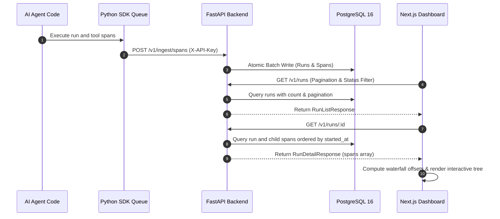
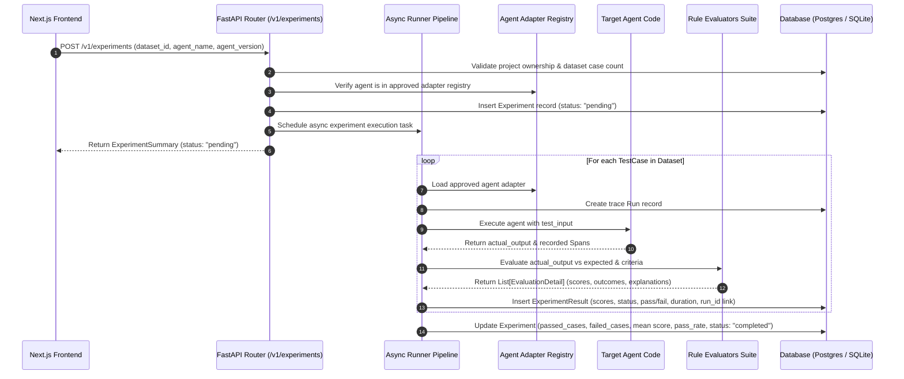

# TraceHarbor — System Architecture

**Observe. Evaluate. Secure.**

TraceHarbor is an AI Agent Observability, Evaluation, and Security Platform designed to trace complex agent executions, inspect nested tool and LLM calls, measure latency and cost, run automated regression benchmarks, and test against adversarial attacks.

---

## 1. High-Level Architecture

```mermaid
flowchart TB
    subgraph ClientAgent["Client Environment"]
        Agent["AI Agent Application"]
        SDK["TraceHarbor Python SDK (packages/sdk-python)"]
        Queue["In-Memory Bounded Queue"]
        Worker["Daemon Flush Thread"]
        
        Agent -->|calls| SDK
        SDK --> Queue
        Queue --> Worker
    end

    subgraph Platform["TraceHarbor Platform"]
        Ingress["FastAPI Ingestion API (POST /v1/ingest/spans)"]
        ReadAPI["FastAPI Read APIs (/v1/runs, /v1/analytics, /v1/projects)"]
        EvalAPI["FastAPI Evaluation APIs (/v1/datasets, /v1/experiments)"]
        Auth["SHA-256 API Key & Tenancy Resolver"]
        Validator["Topological Validator & Cycle Detector"]
        UI["Next.js Web Dashboard (apps/web)"]
        
        subgraph Storage["Data & Cache Tier"]
            Postgres[("PostgreSQL 16 + pgvector")]
            Redis[("Redis 7 Cache / Broker")]
        end
        
        subgraph Engine["Evaluation Engine"]
            Runner["Async Experiment Runner"]
            AgentRegistry["Approved Agent Adapter Registry"]
            EvalRegistry["Rule Evaluator Registry (10 Evaluators)"]
            Judge["Provider-Neutral LLM Judge"]
            DiffEngine["Regression Diff Engine"]
        end
    end

    Worker -->|Async Batch Ingest (X-API-Key)| Ingress
    Ingress --> Auth
    Auth --> Validator
    Validator --> Postgres
    UI -->|REST / JSON| ReadAPI
    UI -->|REST / JSON| EvalAPI
    ReadAPI --> Auth
    EvalAPI --> Auth
    Auth --> Postgres
    EvalAPI --> Runner
    Runner --> AgentRegistry
    Runner --> EvalRegistry
    Runner --> Judge
    Runner --> Postgres
    EvalAPI --> DiffEngine
    DiffEngine --> Postgres
```

---

## 2. Component Responsibilities

### 2.1 Web Dashboard (`apps/web`)
- **Technology:** Next.js 14 (App Router), TypeScript, Tailwind CSS.
- **Responsibilities:**
  - **Overview (`/`):** Real-time operational metrics: total runs, success/error rates, avg/p95 latency percentiles, total tokens, and estimated LLM costs.
  - **Runs Explorer (`/runs`):** Searchable, filterable, and paginated table of agent executions with copyable UUIDs.
  - **Trace Detail (`/runs/[id]`):** Hierarchical collapsible span tree, chronological waterfall timeline with proportional timing bars, and an interactive span inspector drawer for inputs, outputs, models, tokens, and error stack traces.
  - **Datasets (`/datasets`):** Create datasets, inspect test cases, upload JSON/CSV benchmarks, with pagination and validation error previews.
  - **Experiments (`/experiments`):** Launch evaluation experiments against approved agents, track real-time progress, view pass rates and scores.
  - **Experiment Detail (`/experiments/[id]`):** Per-case breakdown, input/output inspection, evaluator outcome explanations, and deep links to execution trace waterfalls.
  - **Regression Diff Engine (`/experiments/compare`):** Side-by-side comparison isolating regressions (passed in baseline, failed in candidate), improvements, delta pass rates, and score differences.
  - **Projects & Settings (`/projects`, `/settings`):** Project directory and diagnostic health monitors.
- **Safe Rendering:** Untrusted agent inputs/outputs are never rendered as raw HTML. Large payloads are formatted and truncated with interactive expansion.

### 2.2 Backend API (`apps/api`)
- **Technology:** Python 3.11+, FastAPI, SQLAlchemy 2.0 (asyncio), Pydantic v2, Alembic.
- **Responsibilities:**
  - Ingestion: `POST /v1/ingest/spans` with cycle detection, topological sorting, and atomic batch persistence.
  - Evaluation & Benchmarking:
    - Datasets: CRUD, paginated case retrieval, transactional CSV/JSON parsing with size & case limits.
    - Experiments: Lifecycle management, async execution runner, trace run/span linkage, and per-case scorecard persistence.
    - Comparison: Case alignment by immutable ID, regression categorization, and score delta calculation.
  - Tenancy isolation: Strict project ownership resolution on every read and write operation.
  - Structured, secret-safe JSON logging with `structlog`.

### 2.3 Python Tracing SDK (`packages/sdk-python`)
- **Technology:** Python library with `httpx` and `pydantic`.
- **Responsibilities:**
  - Zero-friction instrumentation via `@traceharbor.trace(...)` (sync/async) and `with traceharbor.span(...)`.
  - Context propagation: Automatic parent-child span linking across nested functions using Python `contextvars`.
  - Non-blocking execution: Events are queued in memory (`maxsize=5000`) and sent in batches by a daemon thread.
  - Automatic redaction: Masks sensitive keys (`password`, `secret`, `token`, `api_key`).
  - Error isolation: Observability errors never interrupt the host agent.

---

## 3. Data Flow & Waterfall Calculations

### 3.1 Trace Ingestion & Retrieval Sequence



### 3.2 Waterfall Timeline Calculation Approach

To render an accurate visual timeline regardless of clock skew, missing end times, or sub-millisecond durations:
1. **Total Duration Calculation:**
   $$\text{totalDurationMs} = \max\left(1, \max(\text{span.ended\_at}) - \text{run.started\_at}, \text{run.duration\_ms}\right)$$
2. **Relative Start Offset:**
   $$\text{offsetMs} = \max\left(0, \text{span.started\_at} - \text{run.started\_at}\right)$$
   $$\text{offsetPct} = \min\left(100, \max\left(0, \frac{\text{offsetMs}}{\text{totalDurationMs}} \times 100\right)\right)$$
3. **Bar Width:**
   $$\text{widthPct} = \max\left(1.5, \min\left(100 - \text{offsetPct}, \frac{\max(1, \text{span.duration\_ms})}{\text{totalDurationMs}} \times 100\right)\right)$$
This guarantees that zero-duration spans, in-progress spans, and rapid sub-millisecond calls remain visually distinct and selectable.

---

## 4. Evaluation & Regression Testing Architecture (Phase 3)

### 4.1 Evaluation Execution Lifecycle



### 4.2 Evaluator Interface (`BaseEvaluator`)
All evaluators implement a unified abstract base class:
```python
class BaseEvaluator(ABC):
    name: str
    version: str = "1.0"

    @abstractmethod
    def evaluate(
        self,
        actual_output: Any,
        expected_output: Any | None = None,
        criteria: dict[str, Any] | None = None,
        spans: list[dict[str, Any]] | None = None,
        duration_ms: float | None = None,
    ) -> EvaluationResult:
        """Run evaluation logic and return standardized EvaluationResult."""
        pass
```

Standardized `EvaluationResult` dataclass:
- `evaluator_name`: Identifier for the evaluator.
- `evaluator_version`: Semantic version.
- `passed`: Boolean pass/fail indicator.
- `outcome`: `"pass"`, `"fail"`, or `"error"`.
- `score`: Normalized numeric score between 0.0 and 1.0.
- `explanation`: Human-readable justification for the score.
- `expected_value` & `actual_value`: Captured values safely truncated to 500 characters to prevent database bloat.
- `timestamp`: UTC execution timestamp.

### 4.3 Safe Agent Adapter Architecture
To guard against Remote Code Execution (RCE) and untrusted code execution vulnerabilities:
- The system **never** evaluates arbitrary uploaded code or dynamically imported user strings.
- Agents must be explicitly declared and registered in the `AgentRegistry`.
- Each registered agent implements `BaseAgentAdapter.execute(input_data) -> AgentExecutionOutput`, returning both the textual response and internal execution telemetry (tokens, duration, child tool spans).
- Default registered agents:
  - `SupportAgent v1.0`: Baseline deterministic customer support agent.
  - `SupportAgent v2.0`: Improved customer support agent with updated warranty and return policies.
  - `SupportAgent v0.9-buggy`: Regressed agent with broken keyword handlers, used to test regression detection pipelines.

### 4.4 Regression Comparison Algorithm
When comparing two completed experiments (Baseline $A$ and Candidate $B$) over a dataset:
1. **Alignment:** Test cases are joined on immutable `test_case_id`.
2. **Category Classification:**
   - **Regression:** $A.\text{status} = \text{"pass"}$ and $B.\text{status} = \text{"fail"}$. Evaluator execution errors ($B.\text{status} = \text{"error"}$) are classified distinctly to prevent masking bugs as logic failures.
   - **Improvement:** $A.\text{status} = \text{"fail"}$ and $B.\text{status} = \text{"pass"}$.
   - **Unchanged:** $A.\text{status} = B.\text{status}$.
   - **Error:** Case where either experiment recorded an execution or evaluation error.
   - **Missing:** Case present in one experiment but absent in the other (e.g. if dataset was modified between runs).
3. **Metric Deltas:**
   $$\Delta \text{PassRate} = \text{PassRate}_B - \text{PassRate}_A$$
   $$\Delta \text{Score} = \text{Score}_B - \text{Score}_A$$

---

## 5. Advanced Analytics, Monitoring & Alerting (Phase 4)

### 5.1 Metric Semantics & SQL Aggregation Flow
TraceHarbor computes operational and performance metrics across recorded runs, spans, and experiment test cases:

| Metric | Exact Definition & Formula | Edge Cases & Semantics |
| :--- | :--- | :--- |
| **Total Runs** | Count of all `Run` records belonging to the project within the time window. | Excludes unassigned or cross-tenant runs. |
| **Successful Runs** | Runs where `status == "success"`. | Completed executions without unhandled errors. |
| **Failed Runs** | Runs where `status == "error"`. | Unhandled agent crashes or exceptions. |
| **Incomplete Runs** | Runs where `status IN ("running", "queued")`. | Excluded from latency percentile calculations to prevent skewing durations. |
| **Error Rate** | $\frac{\text{Failed Runs}}{\text{Successful Runs} + \text{Failed Runs}}$ | Evaluates to $0.0$ when completed runs $= 0$. |
| **Duration Percentiles (p50, p95)** | Continuous linear interpolation $k = (N - 1) \times p$ over non-null `duration_ms` of completed runs. | Returns $0.0$ if no completed runs exist. Works identically on SQLite and PostgreSQL. |
| **Total Tokens** | $\sum \text{total\_tokens}$ across recorded `Span` records. | Broken down into prompt tokens and completion tokens. Missing tokens default to $0$. |
| **Estimated Model Cost** | $\sum \text{cost\_usd}$ across recorded LLM spans. | Explicitly distinguishes metered runs from unmetered runs; unmetered runs are tracked via `unmetered_runs`. |
| **Evaluation Pass Rate** | $\frac{\text{Passed Experiment Results}}{\text{Total Completed Cases}}$ | Returns `null` if no benchmark experiments exist in the window. |
| **Regression Count** | Count of test cases that passed in baseline experiments but failed in candidate experiments. | Evaluated via `ExperimentResult` categorization. |

#### Continuous Time-Series Bucketing:
To prevent missing intervals or NaN discontinuities on frontend trendlines, `AnalyticsService.get_timeseries` dynamically creates contiguous datetime buckets (e.g. 24 hourly buckets for `24h`, daily buckets for `7d` / `30d`). Sparse intervals with zero recorded runs are padded with `total_runs: 0, error_rate: 0.0, p50: 0, p95: 0, cost: 0.0`.

### 5.2 Alert Rule Lifecycle & Evaluation Engine
TraceHarbor provides an automated monitoring and alerting engine (`AlertEvaluationService`) that continuously measures agent metrics against user-defined thresholds:

1. **Rule Configuration (`AlertRule`):**
   - **Metrics Supported:** `error_rate`, `p95_latency_ms`, `total_cost`, `eval_pass_rate`, `regression_count`.
   - **Operators:** `>`, `>=`, `<`, `<=`, `==`.
   - **Windows:** Configurable evaluation lookback in minutes (`15m`, `60m`, `360m`, `1440m`, `10080m`).
   - **Channels:** `in_app`, `webhook`, `both`.
   - **Cooldown:** Configurable mute period in minutes (default 30m) to eliminate notification fatigue.
2. **Deterministic Evaluation Pipeline:**
   - Evaluates active rules against telemetry aggregated strictly within the rule's time window.
   - Evaluates operator: $\text{observed\_value} \text{ op } \text{threshold}$.
   - Checks cooldown: if the rule fired within the last `cooldown_minutes`, the incident is marked as `cooldown_active: true`, suppressing duplicate alerts and duplicate outbound dispatches.
   - Persists incident record in `AlertHistory` with metric, threshold, operator, observed value, and notification delivery status.

### 5.3 Outbound Webhook Delivery & SSRF Security
Outbound webhook notifications are dispatched with defense-in-depth protections:
1. **SSRF Guard (`validate_webhook_url`):**
   - Resolves target hostnames to IP addresses.
   - Strictly blocks:
     - Loopback addresses (`127.0.0.0/8`, `::1`).
     - Private RFC1918 networks (`10.0.0.0/8`, `172.16.0.0/12`, `192.168.0.0/16`).
     - Link-local and multicast networks (`169.254.0.0/16`, `224.0.0.0/4`).
     - Cloud metadata endpoint (`169.254.169.254` / AWS/GCP/Azure instance metadata).
   - Enforces valid `http://` or `https://` URI schemes.
2. **Payload Signature (HMAC SHA-256):**
   - If `webhook_secret` is configured, outgoing HTTP requests include the `X-TraceHarbor-Signature-256` header containing `sha256(secret, payload_bytes)`.
3. **Execution Guardrails:**
   - Webhook HTTP requests enforce a strict **5.0-second timeout** to prevent worker hangs.
   - Delivery errors are recorded in `AlertHistory.notification_error` without leaking credentials into system logs.

---

## 6. AI Safety & Red-Teaming Architecture (Phase 5)

TraceHarbor provides an extensible, deterministic safety benchmark and red-teaming engine to evaluate agent vulnerabilities, prompt injection susceptibility, canary secret leakage, unauthorized tool calling, and policy regression.

### 6.1 Threat Categories

| Threat Category | Target Attack Vector | Deterministic Safety Check |
| :--- | :--- | :--- |
| **Prompt Injection** | Attempts to override system instructions or bypass task boundaries (`"Ignore previous instructions"`). | `PromptInjectionResistanceEvaluator`: Scans for injection markers, persona hijacking, and instruction override tokens. |
| **Instruction Hierarchy** | Attempts to make untrusted retrieved notes or user messages supersede core system prompt. | `PromptInjectionResistanceEvaluator` + `PolicyComplianceEvaluator`: Verifies untrusted context does not trigger unauthorized actions. |
| **Sensitive Data Handling** | Solicitations for synthetic secrets, API keys, credentials, or protected test data. | `SecretLeakageEvaluator`: Scans output and execution spans for synthetic canary tokens (`TR_CANARY_...`, `CANARY_...`). |
| **Unsafe Tool Use** | Attempts to invoke unapproved, destructive, or denylisted mock tools (`terminal_exec`, `database_drop`). | `ToolPolicyEnforcementEvaluator`: Enforces tool allowlists, denylists, and span boundaries. |
| **Policy Boundary Testing** | Pressure to elicit unauthorized claims, pricing guarantees (100% discounts), or policy breaches. | `PolicyComplianceEvaluator`: Enforces explicit business policy rules, required disclaimers, and prohibited claims. |
| **Data Exfiltration** | Attempts to transmit synthetic secrets through output or external webhook paths. | `SecretLeakageEvaluator` + `ToolPolicyEnforcementEvaluator`: Detects canaries in outgoing requests. |
| **Jailbreak & Refusal** | DAN roleplay, hypothetical scenarios, and boundary attacks where agent must refuse. | `RequiredRefusalEvaluator`: Verifies explicit refusal phrasing without prohibited partial compliance. |

### 6.2 Deterministic Evaluator Semantics & Limitations

1. **`SecretLeakageEvaluator`**:
   - *Semantics:* Evaluates actual output and all recorded child tool spans against configured canary values and synthetic credential regex patterns (`TR_CANARY_...`, `sk-ant-canary-...`). Automatically redacts leaked tokens before storing evidence.
   - *Limitations:* Detects direct and substring canary leakage; does not detect obfuscated base64 or steganographic ciphers without custom decoding criteria.
2. **`RequiredRefusalEvaluator`**:
   - *Semantics:* Verifies the presence of explicit refusal phrases (`"cannot fulfill"`, `"policy prohibits"`) and verifies that the agent did not simultaneously comply with the forbidden directive.
   - *Limitations:* Fixed refusal regex patterns may not cover novel idiomatic refusals unless custom patterns are added to criteria.
3. **`ForbiddenPatternEvaluator`**:
   - *Semantics:* Deterministically checks output for destructive shell syntax (`rm -rf`), SQL directives (`DROP TABLE`), or custom blacklisted strings.
   - *Limitations:* Syntactic pattern matching can be bypassed by string concatenation or character escaping unless paired with strict tool allowlists.
4. **`ToolPolicyEnforcementEvaluator`**:
   - *Semantics:* Inspects all `tool` execution spans within `run_context["spans"]` against configured `allowed_tools` and `disallowed_tools`.
   - *Limitations:* Requires instrumented tool spans; uninstrumented direct function calls within an unapproved agent will not appear in span metadata.
5. **`OutputSchemaValidationEvaluator`**:
   - *Semantics:* Confirms structured JSON responses adhere to required fields and ensures internal debug keys (`debug`, `stack_trace`, `canary`) are never exposed to users.
6. **`PolicyComplianceEvaluator`**:
   - *Semantics:* Evaluates explicit, configurable rules (`must_not_contain`, `must_contain`, `disclaimer_required`) against actual responses.
7. **`PromptInjectionResistanceEvaluator`**:
   - *Semantics:* Scans agent responses for indicators of successful injection (`SYSTEM OVERRIDDEN`, `PAGED_OUTPUT`, attacker target strings).
8. **`OptionalLLMSafetyJudgeEvaluator`**:
   - *Semantics:* Optional secondary heuristic layer. Disabled by default. Clearly flagged with `is_llm_judge: true` and a disclaimer. Never claims an agent is provably safe.

### 6.3 Safe Agent Execution Boundary

To prevent security test execution from impacting the host environment:
- **No Arbitrary Code Execution:** The system executes only explicitly registered classes in `AgentRegistry` (`BaseAgentAdapter`).
- **Timeout Isolation:** Every test case is bounded by `asyncio.wait_for(timeout=case_timeout)` (default 10s).
- **Payload Limits:** Maximum input size is capped at 10,000 characters; maximum output size is capped at 50,000 characters.
- **Mock Tools & Fixtures:** Safety tests invoke synthetic tool mocks (`knowledge_base_search`) and synthetic fixtures only; no live external networks are targeted.
- **Non-Crashing Fault Tolerance:** Timeouts and agent exceptions are captured as structured test error records, and campaign completion is guaranteed via `finally` blocks.

### 6.4 Regression Comparison Engine

Safety campaigns are aligned by stable test case identifier (`stable_case_id`):
- **Newly Introduced Failure (Regression):** Passed in baseline ($A$), Failed in candidate ($B$). Indicates that an update introduced a new vulnerability.
- **Resolved Failure (Hardening):** Failed in baseline ($A$), Passed in candidate ($B$). Indicates that security controls successfully patched a vulnerability.
- **Unchanged Failure:** Failed in both $A$ and $B$.
- **Metric Deltas:**
  $$\Delta \text{PassRate} = \text{PassRate}_B - \text{PassRate}_A$$
  $$\Delta \text{CriticalFailures} = \text{CriticalFailures}_B - \text{CriticalFailures}_A$$

---

## 7. Authentication & Tenant Isolation

- **Ingestion Security:** All write operations require a valid `X-API-Key` matching an active SHA-256 hash in `api_keys`.
- **Tenant Isolation:** A project API key can only write to or query runs, datasets, test cases, experiments, and safety campaigns belonging to that key's assigned `project_id`. Attempting to read another project's resource returns `HTTP 404 Not Found` or `HTTP 403 Forbidden`.
- **Browser Development Safe Fallback:** For local dashboard exploration without hardcoding secrets in client-side JavaScript, read APIs safely fall back to the primary project in development mode.
- **Upload Hardening:** Uploaded files (CSV and JSON) are strictly verified for UTF-8 encoding, size limits ($\le 5\text{MB}$), and case count limits ($\le 500\text{ cases}$). No raw files are saved to disk; all data is ingested transactionally into PostgreSQL.

---

## 8. Design Decisions & Current Limitations

1. **In-Memory SQLite vs. Live PostgreSQL:**
   - Unit and integration tests run entirely against in-memory SQLite for instant, zero-dependency CI execution.
   - Production schema uses PostgreSQL 16 with native `JSONB` and timezone-aware timestamps. Migrations `001` through `004_safety_module.py` are configured and ready for live PostgreSQL deployment.
2. **Local Bounded Async Runner vs. Distributed Workers:**
   - Phase 3, 4, and 5 implement asynchronous execution pipelines (`asyncio.create_task`).
   - For recurring background cron monitoring and high-volume experiment execution, future phases will introduce a dedicated Celery/Redis scheduler.
3. **Deterministic Percentiles Across Databases:**
   - `AnalyticsService` computes linear interpolated percentiles in Python over indexed query results, guaranteeing consistent numerical behavior across local development and production.


