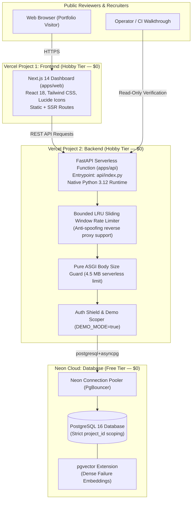

# TraceHarbor — Cloud Deployment Runbook

**Document Version**: 2.0.0 (Zero-Cost Edition)  
**Target Release**: v0.1.0  
**Target Hosting Stack ($0.00 / mo Budget)**:
- **Database**: Neon (PostgreSQL 16 + pgvector, Free Tier — $0.00/mo)
- **Backend API**: Vercel Project 2 (FastAPI Serverless via `@vercel/python`, Hobby Tier — $0.00/mo)
- **Frontend Dashboard**: Vercel Project 1 (Next.js 14 App Router, Hobby Tier — $0.00/mo)
- **CI / Source Repository**: GitHub Free Tier ($0.00/mo)
**Total Monthly Cost**: **$0.00 / month** (₹0.00 / month)  
**Status**: Zero-Cost Deployment Runbook  

---

## 1. Zero-Cost Target Architecture ($0.00/mo)

TraceHarbor is architected for high security, strict tenant isolation, and zero operating costs on standard cloud free tiers:



---

## 2. Strict Zero-Cost Provider Constraints

| Provider | Service | Tier | Monthly Cost | Verification / Guardrails |
|:---|:---|:---|:---:|:---|
| **Vercel** | Next.js Frontend (`apps/web`) | Hobby | **$0.00** | No paid addons. Built-in CDN & SSL. |
| **Vercel** | FastAPI Backend (`apps/api`) | Hobby | **$0.00** | Serverless Python function (`api/index.py`). |
| **Neon** | PostgreSQL 16 + pgvector | Free | **$0.00** | 1 project, 0.5 GiB storage, 100 CU-hours. No credit card required. |
| **GitHub** | Repository & Actions CI | Free | **$0.00** | 2,000 free Actions CI minutes/month. |
| **TOTAL** | **All Services** | **Free** | **$0.00 / mo** | **Strictly ₹0.00 / month.** |

---

## 3. Exact Service Configuration

| Service Tier | Provider | Service Name | Service Type | Runtime / Engine |
|:---|:---|:---|:---|:---|
| **Database** | Neon | `traceharbor-db` | Serverless PostgreSQL | PostgreSQL 16 with pgvector |
| **Backend API** | Render | `traceharbor-api` | Web Service | Python 3 (or Docker) |
| **Frontend** | Vercel | `traceharbor-web` | Web Application | Next.js 14 (Node.js 20) |

---

## 4. Selected Hosting Plans

Two hosting configurations are available:

- **Option A (100% Free / Zero-Dollar Tier)**:
  - Neon: Free Tier ($0/mo)
  - Render: Free Web Service ($0/mo)
  - Vercel: Hobby Tier ($0/mo)
  - *Trade-off*: Render free instance sleeps after 15 minutes of inactivity; first request encounters a 30–60 second cold start delay.
- **Option B (Recommended Recruiter Demo Tier)**:
  - Neon: Free Tier ($0/mo)
  - Render: Starter Web Service ($7.00/mo)
  - Vercel: Hobby Tier ($0/mo)
  - *Advantage*: Always-on backend; zero cold starts; instantaneous response times for recruiters and reviewers.

---

## 5. Current Price Estimates & Currency Conversion

*Exchange Rate Date*: November 2024 / Market Mid-Rate (~₹84.50 – ₹94.50 per 1 USD)

| Service | Plan | Monthly Cost (USD) | Monthly Cost (INR) | Free Tier Limitations & Sleep Behavior |
|:---|:---|:---:|:---:|:---|
| **Neon PostgreSQL** | Free | $0.00 | ₹0 | 1 GB storage, 100 CU-hours/month, sleeps after 5 min idle (wakes in ~1s). |
| **Render Backend (Option A)** | Free | $0.00 | ₹0 | 512 MB RAM, shared CPU, 750 free instance hours/mo, sleeps after 15 min idle (30–60s cold start). |
| **Render Backend (Option B)** | Starter | $7.00 | ~₹660 | 512 MB RAM, 0.5 CPU, **always-on (no sleeping)**, free TLS, custom domains, DDoS filtering. |
| **Vercel Frontend** | Hobby | $0.00 | ₹0 | 100 GB bandwidth, unlimited serverless function invocations within hobby limits. |
| **TOTAL (Option A - Free)** | Free | **$0.00 / mo** | **₹0 / mo** | Cold start latency on idle visits. |
| **TOTAL (Option B - Starter)**| Paid | **$7.00 / mo** | **~₹660 / mo** | **Always-on, zero cold starts, recruiter-optimized.** |

---

## 6. Secret-Generation Instructions

All production secrets must be generated locally using cryptographically secure random number generators. **Never share, commit, or print raw secrets in chat.**

### Generate JWT Secret:
```bash
python -c "import secrets; print(secrets.token_urlsafe(32))"
```
*Output*: A 43-character base64 URL-safe random string.

### Generate Database Password:
```bash
python -c "import secrets; print(secrets.token_hex(16))"
```
*Output*: A 32-character hexadecimal random string.

---

## 7. Neon Database Provisioning Sequence

1. Log into [Neon Console](https://console.neon.tech).
2. Click **Create Project**:
   - **Project Name**: `traceharbor-prod`
   - **Postgres Version**: `16`
   - **Region**: Select region closest to Render (e.g. `US East (Ohio)` / `us-east-2` if Render is in `Oregon`/`Ohio`, or `Frankfurt` if Render is in `Frankfurt`).
3. Neon automatically provisions the primary database and displays connection credentials.
4. Copy the connection string. Neon provides:
   - Pooled connection string (`-pooler` in hostname): Recommended for FastAPI asyncpg connection pool.
   - Example format: `postgresql://th_owner:<PASSWORD>@ep-xyz-pooler.us-east-2.aws.neon.tech/neondb?sslmode=require`
5. Prefix with `postgresql+asyncpg://` for SQLAlchemy:
   ```text
   postgresql+asyncpg://th_owner:<PASSWORD>@ep-xyz-pooler.us-east-2.aws.neon.tech/neondb?sslmode=require
   ```

---

## 8. pgvector Extension Initialization

Neon supports `pgvector` natively. Alembic migration `005_failure_intelligence.py` includes `CREATE EXTENSION IF NOT EXISTS vector;`.

To verify pgvector availability manually via Neon SQL Editor:
```sql
CREATE EXTENSION IF NOT EXISTS vector;
SELECT * FROM pg_extension WHERE extname = 'vector';
```

---

## 9. Controlled Database Migration Command

Execute Alembic migrations from an isolated release workstation or CI step directly against the database URL. **Do not run migrations on API container startup.**

```bash
cd apps/api

# Run all 5 sequential revisions (001 -> 005)
DATABASE_URL="postgresql+asyncpg://<USER>:<PASS>@<HOST>/<DB>?sslmode=require" alembic upgrade head

# Verify current revision
DATABASE_URL="postgresql+asyncpg://<USER>:<PASS>@<HOST>/<DB>?sslmode=require" alembic current
# Expected Output: 005_failure_intelligence (head)
```

---

## 10. Private Synthetic Demo Seeding Command

Populate the database with clean, realistic synthetic demonstration data. This utility guarantees 100% tenant isolation and atomic transaction rollback.

```bash
cd D:\TraceHarbor

# 1. Seed demo tenant (idempotent, rolls back on error)
DATABASE_URL="postgresql+asyncpg://<USER>:<PASS>@<HOST>/<DB>?sslmode=require" python scripts/seed_demo_data.py --reset

# 2. Verify record counts and non-demo isolation
DATABASE_URL="postgresql+asyncpg://<USER>:<PASS>@<HOST>/<DB>?sslmode=require" python scripts/seed_demo_data.py --verify-only
```

*Expected Verification Output*:
```text
=======================================================
 DEMO TENANT VERIFICATION REPORT
 Target Project ID : 00000000-0000-4000-a000-000000000001
=======================================================
 • Runs                  : 2 record(s)
 • Spans                 : 5 record(s)
 • Datasets              : 2 record(s)
 • Test Cases            : 4 record(s)
 • Experiments           : 1 record(s)
 • Safety Campaigns      : 1 record(s)
 • Failure Clusters      : 1 record(s)
 • Failure Events        : 1 record(s)
 • Alert Rules           : 1 record(s)
=======================================================
 [PASS] 100% of verified records belong strictly to the demo project.
 [PASS] Zero cross-tenant data leaked or modified.
```

---

## 11. Vercel Backend Deployment (Project 2 — $0.00/mo)

The backend is deployed as a serverless ASGI application via Vercel's native Python runtime (`@vercel/python`).

1. In [Vercel Dashboard](https://vercel.com), click **Add New...** -> **Project**.
2. Import the `TraceHarbor` repository.
3. Configure Project Settings:
   - **Project Name**: `traceharbor-api`
   - **Framework Preset**: `Other`
   - **Root Directory**: `apps/api`
   - **Build Command**: *(leave empty; Vercel detects requirements.txt)*
   - **Output Directory**: *(leave default)*
4. Configure Environment Variables in Vercel for the Backend:

| Key | Value / Recommendation | Note |
|:---|:---|:---|
| `DATABASE_URL` | `postgresql+asyncpg://<USER>:<PASS>@<HOST>/<DB>?sslmode=require` | Use Neon pooled connection URL (`-pooler`) |
| `DB_POOL_SIZE` | `2` | Optimized for serverless functions |
| `DB_MAX_OVERFLOW` | `3` | Prevents Neon connection exhaustion |
| `DB_POOL_RECYCLE` | `300` | Recycles idle connections cleanly |
| `JWT_SECRET` | `<Generated 32-byte cryptographic secret>` | Required for authentication |
| `DEBUG` | `false` | Enforces production mode |
| `DEMO_MODE` | `true` | Enables safe public demo mode |
| `DEMO_PROJECT_ID` | `00000000-0000-4000-a000-000000000001` | Fixed UUID for the demo tenant |
| `CORS_ORIGINS` | `https://traceharbor-web.vercel.app` | Set to your Vercel frontend URL |
| `RATE_LIMIT_ENABLED` | `true` | Enables anti-abuse rate limiter |
| `RATE_LIMIT_DEMO_PER_MINUTE` | `60` | 60 requests/minute for demo users |
| `RATE_LIMIT_AUTH_PER_MINUTE` | `300` | 300 requests/minute for authenticated users |
| `MAX_REQUEST_BODY_BYTES` | `4500000` | 4.5 MB serverless function payload limit |
| `PROXY_HEADERS_ENABLED` | `true` | Honors reverse proxy headers |
| `TRUSTED_PROXIES` | `127.0.0.1,::1,testclient` | Reverse proxy trust list |
| `LOG_LEVEL` | `INFO` | Standard structured logging |

5. Deploy. Record the assigned backend URL (e.g. `https://traceharbor-api.vercel.app`).

---

## 12. Vercel Frontend Deployment (Project 1 — $0.00/mo)

The frontend is deployed on Vercel's Edge/Next.js hosting with zero hosting cost.

1. In [Vercel Dashboard](https://vercel.com), click **Add New...** -> **Project**.
2. Import the `TraceHarbor` repository.
3. Configure Project Settings:
   - **Project Name**: `traceharbor-web`
   - **Framework Preset**: `Next.js`
   - **Root Directory**: `apps/web`
   - **Build Command**: `npm run build`
   - **Output Directory**: `.next`
   - **Node.js Version**: `20.x`
4. Configure Environment Variables in Vercel for the Frontend:

| Key | Value | Note |
|:---|:---|:---|
| `NEXT_PUBLIC_API_BASE_URL` | `https://traceharbor-api.vercel.app` | Assigned URL of Project 2 (no trailing slash) |
| `NEXT_PUBLIC_API_URL` | `https://traceharbor-api.vercel.app` | Secondary alias for API base URL |
| `NEXT_PUBLIC_DEMO_KEY` | *(leave empty)* | Triggers automatic unauthenticated demo access |

5. Deploy. Record the assigned frontend URL (e.g. `https://traceharbor-web.vercel.app`).
6. If the assigned frontend URL differs from `CORS_ORIGINS`, update `CORS_ORIGINS` in the backend project settings.

---

## 13. CORS Configuration

- Render FastAPI requires explicit domains in `CORS_ORIGINS`.
- Wildcards (`*`) are prohibited and rejected at startup when `DEBUG=false`.
- Ensure exact matching without trailing slash: `https://traceharbor.vercel.app`.
- If custom domains are added later, add them comma-separated:
  ```text
  CORS_ORIGINS=https://traceharbor.vercel.app,https://traceharbor.dev
  ```

---

## 14. Health and Readiness Verification

Test backend probes immediately after deployment:

```bash
# 1. Liveness probe (returns 200 alive)
curl -i https://traceharbor-api.onrender.com/healthz

# 2. Readiness probe (validates database connectivity)
curl -i https://traceharbor-api.onrender.com/readyz

# 3. Platform metadata
curl -i https://traceharbor-api.onrender.com/health
```

---

## 15. Public Demo Access Validation

Verify that public unauthenticated reads succeed while mutations and cross-tenant queries are blocked:

```bash
# 1. Unauthenticated read of synthetic runs (Must return 200 OK)
curl -i https://traceharbor-api.onrender.com/v1/runs

# 2. Unauthenticated read of synthetic failure clusters (Must return 200 OK)
curl -i https://traceharbor-api.onrender.com/v1/failures/clusters

# 3. Attempt mutation without key (Must return 403 Forbidden)
curl -i -X POST https://traceharbor-api.onrender.com/v1/datasets \
  -H "Content-Type: application/json" \
  -d '{"name": "Unauthorized Dataset"}'

# 4. Attempt telemetry ingestion without live key (Must return 401/403)
curl -i -X POST https://traceharbor-api.onrender.com/v1/ingest/spans \
  -H "Content-Type: application/json" \
  -d '{"runs": [], "spans": []}'
```

---

## 16. Live Walkthrough Verification

Execute the non-mutating demo verification suite against the live deployment:

```bash
python scripts/demo_walkthrough.py --base-url https://traceharbor-api.onrender.com --verify-demo
```

*Expected Result*: All 10 verification steps succeed with `[PASS]`, confirming end-to-end operational health.

---

## 17. Rollback Procedure

If unexpected errors occur during deployment:

1. **Frontend Rollback (Vercel)**:
   - In Vercel Dashboard -> **Deployments**, click the previous successful deployment -> **Instant Rollback**.
2. **Backend Rollback (Render)**:
   - In Render Dashboard -> **Deploys**, click the prior working build -> **Rollback to this deploy**.
3. **Database Schema Rollback (Alembic)**:
   - To roll back a migration:
     ```bash
     cd apps/api
     DATABASE_URL="..." alembic downgrade -1
     ```
4. **Data Reset**:
   - To cleanly re-seed synthetic data:
     ```bash
     DATABASE_URL="..." python scripts/seed_demo_data.py --reset
     ```

---

## 18. Post-Deployment Security Checklist

- [ ] `DEBUG=false` confirmed on Render.
- [ ] `DEMO_MODE=true` confirmed on Render.
- [ ] `DEMO_PROJECT_ID` set to `00000000-0000-4000-a000-000000000001`.
- [ ] `PROXY_HEADERS_ENABLED=true` set on Render.
- [ ] `CORS_ORIGINS` strictly set to the Vercel domain (no wildcard `*`).
- [ ] `NEXT_PUBLIC_*` contains zero secret tokens (`th_live_*`, `sk-*`, database credentials).
- [ ] Mutation endpoints (`POST`, `PUT`, `PATCH`, `DELETE`) return `HTTP 403` to unauthenticated callers.
- [ ] Rate limiting active (`X-RateLimit-Limit`, `X-RateLimit-Remaining` headers present in responses).
- [ ] Request bodies > 10 MB rejected with `HTTP 413`.
- [ ] Database credentials not logged in Render runtime logs (verified via log redaction).

